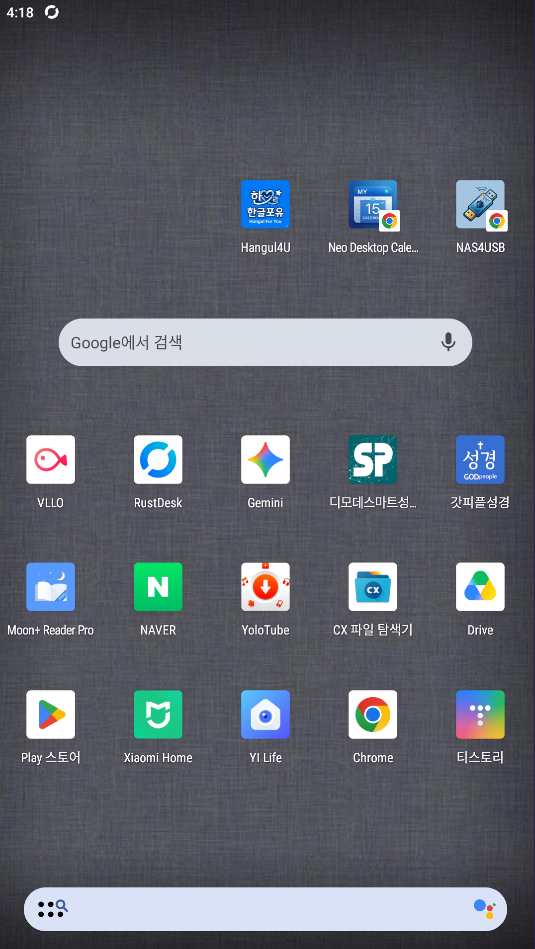
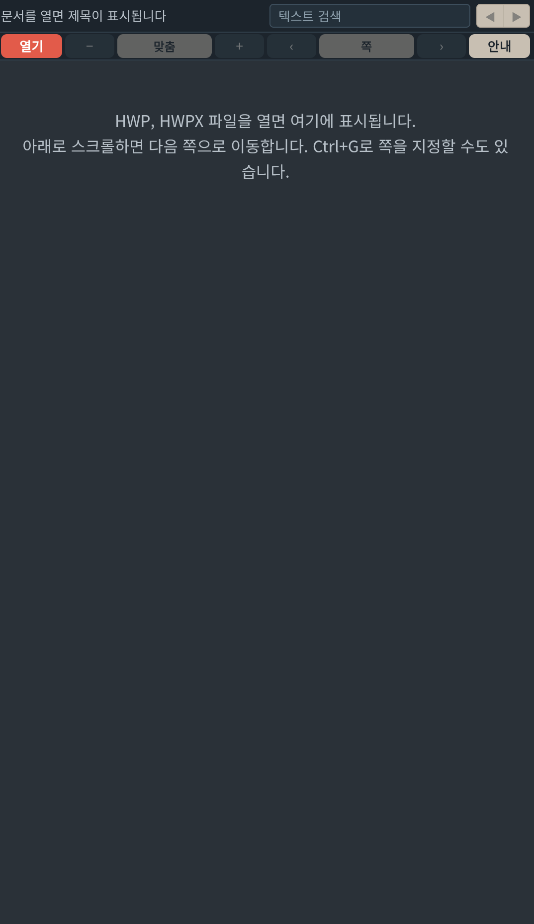
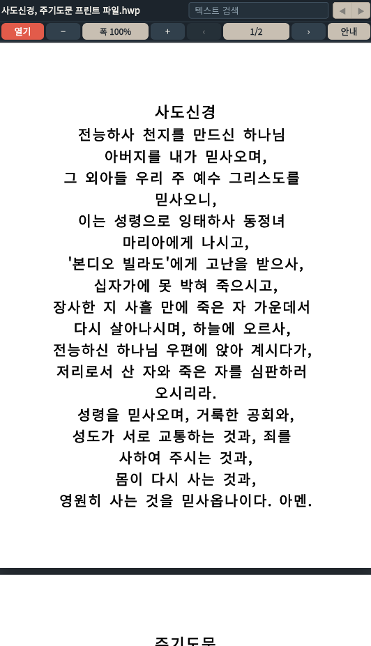

# Hangul4U

<p align="center">
  
</p>

Hangul4U는 Android에서 HWP, HWPX 파일을 기기 안에서 보는 뷰어입니다. 버전 1.0.2.

문서를 고르면 그 파일이 기기 메모리에서 열립니다. 인터넷 권한은 없고, 문서를 서버로 보내지 않습니다. 계정, 광고, 이용 통계도 없습니다.

한글, 한/글, 한컴오피스, HWP, HWPX와 관련 로고는 주식회사 한글과컴퓨터의 상표입니다. Hangul4U는 한글과컴퓨터 및 한컴오피스와 관계가 없으며, 그 프로그램의 화면, 글꼴, 아이콘, 이름을 사용하지 않습니다.

## 스크린샷

### 홈 화면 아이콘



### 시작 화면



### 문서 보기



## 사용

- **열기**로 HWP, HWPX를 고릅니다. 다른 앱에서 이 형식으로 열어도 받을 수 있습니다.
- 위쪽 칸에서 문서 안의 글자를 찾고, 이전·다음 결과로 이동합니다.
- **폭 100%**는 화면 너비에 맞춥니다. 한 번 더 누르면 쪽 전체가 보이는 쪽맞춤이 됩니다. **−**, **+**는 5%씩 조절하고, 두 손가락으로도 확대할 수 있습니다. 범위는 25%부터 300%까지입니다.
- **‹**, **›**와 방향키로 쪽을 넘깁니다. 쪽 번호를 누르면 원하는 쪽으로 이동합니다.
- 비밀번호가 있는 문서는 열 때 비밀번호를 묻습니다.
- 한 파일의 크기는 80MB까지입니다.

Android 8.0(API 26) 이상이 필요합니다.

## 빌드

JDK 17과 Node.js(npm)가 필요합니다. 프로젝트 폴더에서 디버그 APK를 만듭니다.

```bat
.\gradlew.bat assembleDebug
```

빌드 전에 `engine\rhwp.version`에 적힌 [`@rhwp/core`](https://www.npmjs.com/package/@rhwp/core)를 받아 `app\src\main\assets\viewer`에 넣습니다. 같은 버전은 `engine\cache`에 보관해 다시 받지 않습니다.

npm에 올라온 최신 엔진으로 올리고 그 버전을 고정값으로 저장하려면:

```bat
.\gradlew.bat assembleDebug -Prhwp=latest
```

특정 버전으로 고정하려면 `-Prhwp=0.8.7`처럼 적습니다. 엔진만 맞추려면 `node tools\sync-rhwp.mjs` 또는 `.\gradlew.bat syncRhwp`를 실행합니다.

빌드가 끝나면 `dist\Hangul4U-debug_v1.0.2_YYMMDD_HHMMSS.apk`처럼 패키징 시각이 붙은 이름으로 복사됩니다. Gradle 기본 출력은 `app\build\outputs\apk\debug\app-debug.apk`에도 남아 있습니다.

사용하는 도구는 Gradle 8.11.1, Android Gradle Plugin 8.7.3, Kotlin 2.0.21입니다. `compileSdk`와 `targetSdk`는 35이고, `minSdk`는 26입니다.

## 화면 미리보기

뷰어 화면은 `app\src\main\assets\viewer`에 있습니다. 브라우저에서 보려면 Node.js로 다음을 실행합니다.

```bat
node tools\dev-server.mjs
```

주소는 http://127.0.0.1:8765/ 입니다. `samples` 폴더의 파일은 `/samples/`로 열 수 있습니다.

## 문서 표시

쪽 그리기에는 [rhwp](https://github.com/edwardkim/rhwp) `@rhwp/core`를 사용합니다. 쓰는 버전은 `engine\rhwp.version`과 `app\src\main\assets\viewer\rhwp-version.txt`에 적혀 있습니다. Copyright (c) 2025-2026 Edward Kim. MIT License. 라이선스 전문은 `app\src\main\assets\viewer\LICENSE-rhwp.txt`에 있습니다.

글꼴과 그리기 방식의 차이로 한글과컴퓨터 프로그램과 쪽 나눔, 표, 글자 위치가 다르게 보일 수 있습니다. 표의 쪽 나눔은 이 엔진이 계산한 결과를 따릅니다.

## 앱 라이선스

rhwp의 MIT 라이선스와 별도로, Hangul4U 자체에 적용할 배포 라이선스는 이 초안에서 정하지 않았습니다.
